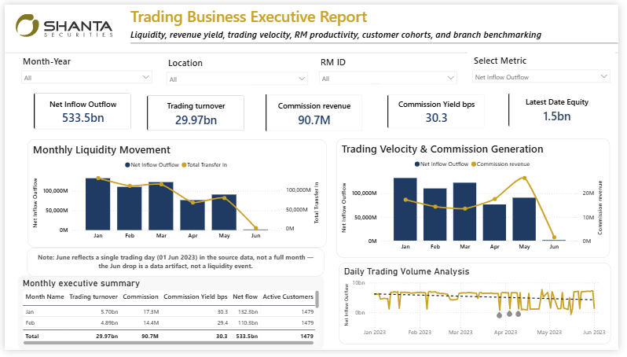

# Trading Business Analytics (Power BI)

A four-page Power BI report built for a securities brokerage trading business as a data analyst technical assessment. It covers liquidity movement, trading turnover and commission yield, relationship manager (RM) productivity, customer activity cohorts, and branch benchmarking.

> **Data note:** The dataset and the `.pbix` file are not included in this repository, because the data belongs to the assessment provider. This repo contains screenshots, a demo video and documentation of the approach only.

---

## Demo

[Watch the 75-second walkthrough](Trading_Business_Executive_Report.mp4)

## Dashboard preview

| Executive View | RM Productivity |
|---|---|
|  |  |

| Customer Cohorts | Branch Performance Benchmarking |
|---|---|
|  |  |

---

## Business questions

1. How much liquidity is flowing in, and how does it relate to trading turnover and commission?
2. How efficiently does the business convert turnover into commission (yield in basis points)?
3. Which RMs drive turnover, and how concentrated is their output?
4. How are customers segmented by activity, and what does each cohort contribute?
5. Which branches perform best once size (customers, equity) is taken into account?

## Dashboard pages

| Page | What it shows |
|---|---|
| **Executive View** | Net inflow/outflow, trading turnover, commission revenue, commission yield (bps) and latest equity; monthly liquidity movement; trading velocity vs commission; daily trading volume with anomaly detection; monthly executive summary table; a metric selector that switches the charts between measures |
| **RM Productivity** | Median RM turnover and customers, top RM turnover and yield, top-quartile share; top 10 RMs by turnover coloured by yield; RM leaderboard; key influencers analysis for commission yield |
| **Customer Cohorts** | Customer activity cohorts and how turnover and equity differ between them |
| **Branch Performance Benchmarking** | Decomposition tree from location to RM to activity cohort; branch positioning (average equity vs turnover); benchmark table with turnover per customer and turnover-to-equity ratio |

## Key figures (Jan to Jun 2023)

| Metric | Value |
|---|---|
| Net inflow/outflow | 533.5bn |
| Trading turnover | 29.97bn |
| Commission revenue | 90.7M |
| Commission yield | 30.3 bps |
| Active customers | 1,479 |
| Median RM turnover | 274.3M |
| Top RM turnover | 2.3bn |
| Top RM commission yield | 42.5 bps |
| Top-quartile RM share of turnover | 64.2% |

## Data quality note

June contains a single trading day (1 June 2023) in the source data. The sharp drop in June in the monthly charts is therefore a data artifact, not a liquidity event. The Executive View carries an on-page note saying so, so readers do not misread the trend.

## Technical highlights

- **Data model:** star schema built for the assessment dataset, with a date dimension and shared dimensions for location and RM.
- **DAX:** KPI measures for turnover, commission, commission yield (bps), net flow, RM medians and top-quartile share, plus a metric selector driven by a field parameter.
- **Advanced visuals:** anomaly detection on daily trading volume, key influencers for commission yield, decomposition tree for branch analysis.
- **Design:** consistent navy and gold theme, page navigation, filter panel with Month-Year, Location and RM ID slicers.
- **Delivery:** published to Power BI Service.

## Repository structure

```
.
├── README.md
├── demo/
│   └── Trading_Business_Executive_Report.mp4
└── screenshots/
    ├── 01_executive_view.png
    ├── 02_rm_productivity.png
    ├── 03_customer_cohorts.png
    └── 04_branch_benchmarking.png
```

## Tools

Power BI Desktop · Power BI Service · DAX · Power Query (M) · Excel

## Author

**Your Name**
[LinkedIn](https://www.linkedin.com/) · [GitHub](https://github.com/)
